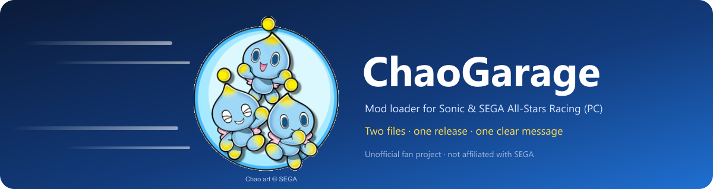

<p align="center">
  
</p>

<p align="center">
  <a href="https://github.com/Demaunix/ChaoGarage/releases/latest"></a>
</p>

<p align="center">
  <a href="https://github.com/Demaunix/ChaoGarage/releases/latest"></a>
  
  
  <a href="LICENSE"></a>
</p>

**ChaoGarage** loads mods into *Sonic & SEGA All-Stars Racing* (Steam, PC). It is two small files that sit next to the game:

| File | What it does |
|---|---|
| `ChaoGarage.dll` | the loader: reads `mods\`, checks every mod, prepares their files and starts their code |
| `dinput8.dll` | the bootstrap: lets the game start `ChaoGarage.dll` at the right moment, otherwise passes everything to Windows' own DirectInput |

They are released **together** and only work **as a pair from the same release**. Mods are separate downloads (for example on GameBanana) and do **not** bring their own copy of these files.

---

## Quick start

1. **Download** `ChaoGarage-<version>-win32.zip` from the [latest release](https://github.com/Demaunix/ChaoGarage/releases/latest).
2. In Steam: right-click *Sonic & SEGA All-Stars Racing* → **Manage → Browse local files**. This opens the folder with the game's `.exe`.
3. **Copy both** `ChaoGarage.dll` and `dinput8.dll` from the ZIP into that folder (replace older copies of both files).
4. Put each mod's folder into the `mods` folder there (create it if it is missing): `mods\<Mod Name>\mod.ini`.
5. Start the game through Steam as usual.

No installer, no service, no background updater: removing the two files returns the game to normal. ChaoGarage itself changes neither your saves nor the game's own files (what a mod's own code does is up to that mod). Details: [docs/INSTALL.md](docs/INSTALL.md).

> **Already have the loader because a mod shipped it?** Older mod packages (for example *Metal Sonic 1.1.0 Beta 3*) included `ChaoGarage.dll` and `dinput8.dll`. Replace **both** with this release. 1.1.0 reads the same mod format as those files (`mod.ini` schema 1, `plan.json` schema 1) and verifies, combines and serves mods with unchanged code, so mod folders need no changes. Mixing one new and one old file is refused with a message (see below).

## Compatibility at a glance

| You have | What happens |
|---|---|
| ChaoGarage 1.1.0 (both files) + mods without `allstars-mod.json` (the legacy format) | load as before — no new checks apply to them |
| 1.1.0 + a mod that declares its loader needs in `allstars-mod.json` | checked before anything starts; refused with a message if not met |
| 1.1.0 `ChaoGarage.dll` + an older `dinput8.dll`, or the other way round | refused with the "different releases" message; install both files again |
| an older loader (before 1.1.0) + a new mod | the old loader does not enforce the new description-file requirements (it never reads `allstars-mod.json`); it still checks manifests, hashes, plans and conflicts. A mod can protect itself with the [runtime check](examples/mod-runtime-check) — see [docs/MOD-AUTHORS.md](docs/MOD-AUTHORS.md) |
| the game's `.exe` is not the supported Steam build (or is patched) | mods are not started; a message says so |

The loader cannot know which version is "newest" on the internet: it compares what is on disk with what the mods declare. Details, including what the loader, the All-Stars Mod Manager and its checker (`AllStarsModCheck`) each enforce: [docs/COMPATIBILITY.md](docs/COMPATIBILITY.md).

## For mod authors

* Do **not** put `ChaoGarage.dll` or `dinput8.dll` in your mod ZIP. Link to this page's releases instead — ready-to-paste text for GameBanana is in [docs/MOD-AUTHORS.md](docs/MOD-AUTHORS.md#text-for-your-gamebanana-page).
* To require a loader feature, list it in your `allstars-mod.json`:
  ```json
  { "manifest_schema": "allstars-mod/1", "id": "my-mod",
    "loader": { "host_abi": 1, "capabilities": ["startup-requirements-check"] } }
  ```
* To also warn players who still run a loader **older** than 1.1.0, add the three-line [runtime check](examples/mod-runtime-check/chaogarage_require.h) to your DLL.

## Verify a download

Every release lists the SHA-256 of each file (`SHA256SUMS.txt`) and ships `BUILD-INFO.json` naming the exact source it was built from. The build is reproducible: building the tagged source with the pinned compiler gives the same bytes, wherever the source folder is. See [docs/BUILDING.md](docs/BUILDING.md).

## Project

* [Changelog](CHANGELOG.md) · [Design notes](docs/DESIGN.md) · [Release procedure](docs/RELEASE-PROCEDURE.md) · [Contributing](CONTRIBUTING.md)
* Original code: [MIT license](LICENSE). The DLLs also contain Microsoft C/C++ runtime code linked by the compiler: [THIRD-PARTY-NOTICES.md](THIRD-PARTY-NOTICES.md).
* *Sonic*, *SEGA* and *Sonic & SEGA All-Stars Racing* are trademarks of SEGA. ChaoGarage is an unofficial fan project, not affiliated with or endorsed by SEGA, and contains no game files.
